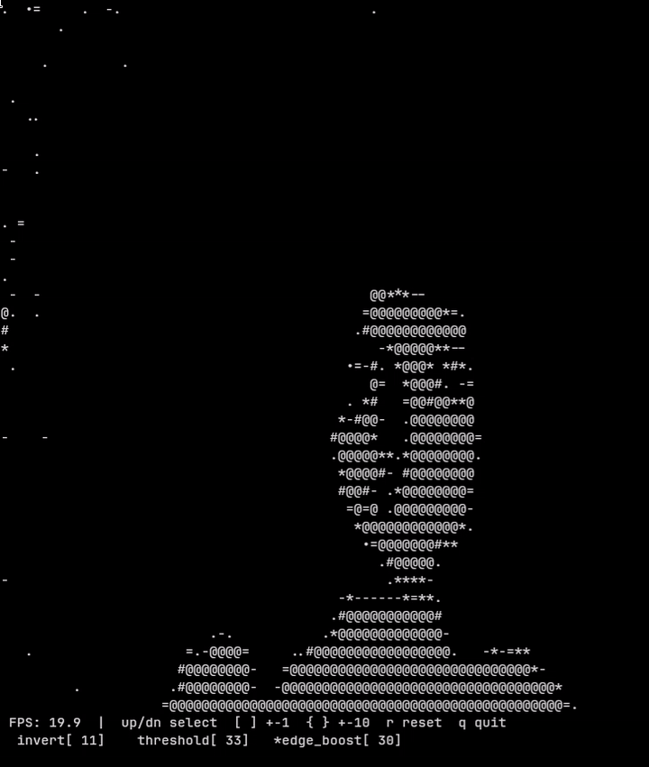
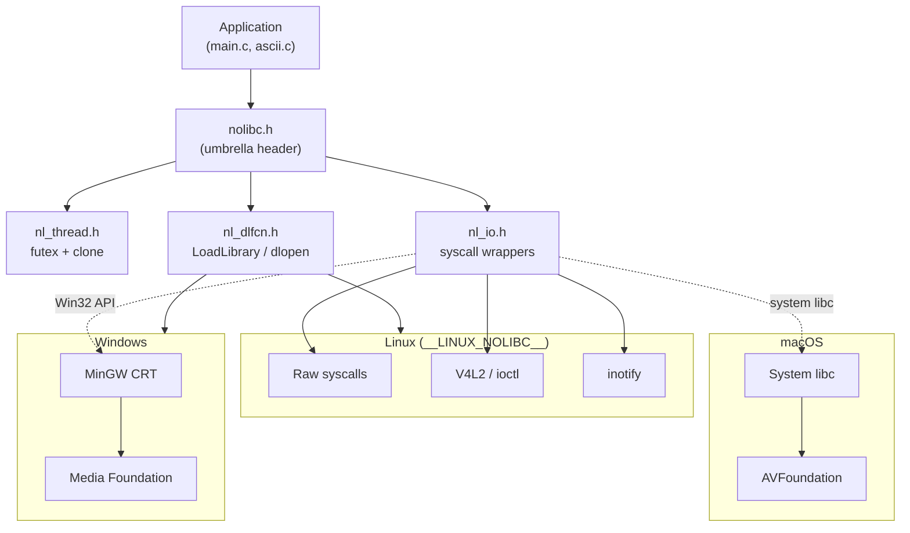

# AsciiCam

[](https://github.com/Harshit-Dhanwalkar/AsciiCam/actions/workflows/ci.yml)
[](https://polyformproject.org/licenses/noncommercial/1.0.0/)


Real-time webcam video rendered as ASCII art directly in the terminal

Written in C99. Ships its own minimal libc layer (`nolibc`) on Linux: the binary is
statically linked with no runtime dependencies (plugins load through its own
ELF loader, `nl_dlfcn`). Uses platform-native capture backends:
V4L2 on Linux, AVFoundation on macOS, Media Foundation on Windows.

<p align="center">
  
  
</p>

---

## Features

| Feature                      | Details                                                                                                                                           |
| ---------------------------- | ------------------------------------------------------------------------------------------------------------------------------------------------- |
| **YUYV to grayscale**        | SSE2 SIMD (`yuyv_to_gray_simd`) - 16 pixels per iteration on x86_64, NEON on ARM64                                                                |
| **Picture as camera**        | `--image photo.png`: PNG, JPEG or PGM/PPM through every render mode, effect and plugin; a folder is a slideshow; own decoders, no zlib or libjpeg |
| **YUYV to RGB**              | Fixed‑point BT.601 conversion for truecolor output                                                                                                |
| **Render modes**             | Braille, Blocks, ASCII ramp, Half-block, Dots - cycle live with `m`/`M`                                                                           |
| **Edge detection**           | Sobel, Sobel with direction, Laplacian - toggle with `x`/`X`                                                                                      |
| **Image adjustments**        | Brightness, contrast, gamma (`-g 10..400`), invert mapping                                                                                        |
| **Tone curve**               | Draw a brightness curve with the mouse in the side panel (`k`), presets, `--curve`; applies to every render mode and colour                       |
| **Pseudo-3D depth pop**      | Parallax displacement based on brightness — `+`/`-`/`v`                                                                                           |
| **Floyd‑Steinberg dither**   | Error‑diffusion to reduce banding                                                                                                                 |
| **ANSI color**               | Truecolor (`-C`) or xterm-256 (`-2`) per-cell foreground                                                                                          |
| **ANSI truecolor**           | `\033[38;2;R;G;Bm` per‑cell coloring                                                                                                              |
| **Hot‑reloadable charsets**  | Load `.txt` ramps from a directory, switch with `n`/`N`, monitor with inotify                                                                     |
| **Hot‑reload plugin system** | `inotify` + `dlopen` - rebuild a filter `.so`, it reloads live                                                                                    |
| **SIGWINCH auto-resize**     | Terminal resize re-queries `TIOCGWINSZ` and reallocates buffers                                                                                   |
| **FPS‑capped render loop**   | `CLOCK_MONOTONIC` + `nanosleep` frame pacing                                                                                                      |
| **Capture thread**           | Linux: capture + luma conversion on a `clone()`d thread, triple-buffered hand-off to the render loop; `-T` captures inline                        |
| **Hardware camera controls** | V4L2 exposure, contrast, white-balance via `ioctl` - live keys `e`/`E`, `c`/`C`, `w`/`W` (Linux only; macOS/Windows display `n/a`)                |
| **Cross-platform**           | Linux (V4L2, nolibc), macOS (AVFoundation, system libc), Windows (Media Foundation, MinGW)                                                        |

- Linux: requires `gcc` only (no kernel headers, `libdl` or `libpthread`).
- macOS: requires `Clang` and `AVFoundation` frameworks (linked automatically).
- Windows: requires `MinGW-w64`; links `mfplat`, `mf`, `mfreadwrite`, `mfuuid`, `ole32` (Media Foundation).

## Architecture



On Linux, the application makes raw `syscall(2)` invocations instead of
calling into glibc. Threading (when enabled) uses `clone()` + `futex(2)`
directly - no `libpthread`. Plugins are loaded by a from-scratch ELF loader
(`nl_dlfcn`), so the Linux binary is fully static with no glibc dependency.
macOS and Windows still use their system libraries.

---

## Install

```sh
curl -fsSL https://raw.githubusercontent.com/Harshit-Dhanwalkar/AsciiCam/main/scripts/install.sh | sh   # to ~/.local
nix run github:Harshit-Dhanwalkar/AsciiCam
```

`.deb`, Homebrew tap, AUR and a signed apt repository: see [packaging/README.md](packaging/README.md).

---

## Build

```bash
git clone https://github.com/Harshit-Dhanwalkar/AsciiCam.git
```

or via ssh

```bash
git clone git@github.com:Harshit-Dhanwalkar/AsciiCam.git
```

### Linux / macOS

Navigate in `C` directory and build

```bash
cd AsciiCam/C/
make
```

### Windows (MinGW-w64)

From a Git Bash prompt with MinGW-w64 on `PATH`:

```bash
cd AsciiCam/C
make CC=gcc
```

This produces build/asciicam (.exe on Windows) and compiles any
plugins in filters/ into build/\*.{so,dylib,dll}.

### Requirements:

- Linux: `gcc` (V4L2 ABI and everything else is vendored under `lib/`)
- macOS: `clang`, AVFoundation (linked automatically)
- Windows: MinGW-w64; links `mfplat`, `mf`, `mfreadwrite`, `mfuuid`, `ole32`

### Tests (Linux)

`make test` builds and runs the dependency-free unit tests (allocator, printf,
ELF loader, fuzz, mouse, capture reinit, plugin catalog, threads, capture
pipeline, filter security)

`make e2e` runs the real main loop against a software camera in a pty (threaded
and `-T`, colour, padded rows, and a wedged camera) - no webcam needed.

## Run

Run is via `make run`, which builds first and then launches the binary.
Pass arguments through the `ARGS` variable:

```bash
# Basic (grayscale, 80x40, /dev/video0)
make run

# Truecolor output
make run ARGS="-C"

# Braille rendering at 30 fps
make run ARGS="-C -m braille -f 30"

# With all three plugins
make run ARGS="-p build/invert.so -p build/threshold.so -p build/edge_detect.so"

# Edge detection mode, custom resolution
make run ARGS="-E sobel -w 320 -h 240 -W 120 -H 50"

# Dithering + inverted charset
make run ARGS="-D -i"

# Gamma correction: 50 = darker midtones, 200 = brighter
make run ARGS="-g 200"

# 256-color output (for terminals without truecolor)
make run ARGS="-2"
```

You can also run the binary directly:

```bash
./build/asciicam -C -m braille
./build/asciicam -p build/invert.so -p build/edge_detect.so
./build/asciicam --help
```

### Config file:

AsciiCam reads ./.asciicamrc on startup if present. Keys mirror the CLI
flags and are overridden by any flag passed on the command line.

```bash
# .asciicamrc
device = /dev/video0
capture_width = 640
capture_height = 480
fps = 30
render_mode = braille
color = 1
color_mode = 256
gamma = 150
curve = 0,0 64,40 192,220 255,255
plugin = build/invert.so
```

---

## A picture instead of a camera: `--image`

```sh
asciicam --image photo.png -C                  # same as -d image:photo.png
asciicam --image ~/Pictures/trip -C            # slideshow of a folder
asciicam --image ~/Pictures/trip --slide 10 -C
```

Shows a PNG, a JPEG or a binary PGM/PPM (`P5`/`P6`) as if it were the camera, so any
picture goes through the render modes, the effects, the plugins, recording and
`--vcam`. The picture is shrunk by area average to fit the capture size, aspect
ratio kept, with black bars where it does not fill; transparency is shown over
black. It is a still: brightness, contrast, gamma, edge detection and the plugins
still react live.

### Slideshow

Give `--image` a folder and it shows its pictures (`png`, `jpg`, `jpeg`, `pgm`,
`ppm`, `pnm`) one after another, in natural order (`img2` before `img10`),
`--slide <seconds>` per picture (default 5, `0` = only on key). `.` shows the next
picture and `,` the previous one, wrapping around; a toast names the picture
(`3/12  img3.png`). Hidden files, sub-folders and other files are left out, at most
512 pictures are used, and a picture that cannot be read is skipped. The list is
read once at start. The effects, curve, colour map and plugins work on every
picture as on the still one. Code is in `src/slides.c`.

The decoders are in `src/image.c` (PNG, with its own inflate, RFC 1951) and
`src/jpeg.c` (baseline JPEG: Huffman, integer IDCT, any chroma subsampling, restart
markers), so there is still no zlib and no libjpeg.
PNGs of every colour type and bit depth are read, interlaced (Adam7) ones included.
Progressive JPEG, arithmetic-coded JPEG and CMYK JPEG are not, and say so (re-save
as baseline JPEG or PNG). Pictures up to 4096 x 4096 pixels.

---

## Plugin system

Plugins are shared libraries (`.so` on Linux, `.dylib` on macOS, `.dll` on
Windows). Hot-reload is only available on Linux; the macOS and Windows
builds load plugins once at startup.

```bash
gcc -O2 -fPIC -shared -Iinclude filters/my_filter.c -o build/my_filter.so
./build/asciicam -p build/my_filter.so
```

**Hot-reload:** Linux: the binary watches the `.so` with `inotify`. Recompile the plugin while the viewer is running and it reloads automatically within $\approx$100 ms.

### Effect plugins

Besides `edge_detect`, `invert` and `threshold`, `filters/` holds 19 effects.
Each takes one parameter 0-255 (the `[128]` in the panel): 0 is "off", 128 is a
default. `process()` only sees the luma plane, so in mono mode the "colour"
effects (`thermal`, `sepia`, `chromatic`) are tone-curve approximations. In
colour mode (`-C`) they also repaint the picture itself: a heat palette, a
brown sepia tint, red and blue channels sliding apart.

**Colour hook for your own plugins:** export, next to `plugin_get()`,

```c
void plugin_rgb_process(uint8_t *rgb, int w, int h, void *ctx);
```

`rgb` is `w*h*3` bytes (R G B per pixel). In colour mode the host builds the
picture from the plugins' luma output and then calls every plugin's
`plugin_rgb_process` in order, with the same parameter. It is optional: plugins
without it load and run exactly as before, and the interface version
(`PLUGIN_ABI`) did not change.

| Look    | Plugins                                                                                                                        |
| ------- | ------------------------------------------------------------------------------------------------------------------------------ |
| Analog  | `crt` (curved screen, scanlines), `vhs` (wobble, tracking band), `tv_static`, `chromatic` (edge fringing), `vignette`, `sepia` |
| Digital | `glitch` (bursts), `pixel_sort`, `matrix_rain`, `dither_bayer`, `dither_fs` (levels set by the parameter)                      |
| Motion  | `trails` (ghosting), `framediff` (highlight what moved), `motion` (detector: frames what moves, meter at the bottom)           |
| Shape   | `neon_edge`, `ripple`, `fisheye`, `kaleidoscope` (2/4/8-fold), `thermal` (heat bands)                                          |

Shared helpers (bounds check, parameter clamp, integer sine and square root, PRNG)
live in `include/fx.h`; none of the effects use floating point, libm or `malloc`.
Stateful ones (`trails`, `framediff`, `motion`, `glitch`, `matrix_rain`, ...) keep
their history in static buffers sized for up to 1920x1080 and pass larger frames
through untouched.

### Shipping plugins

The program binary contains **no plugin code** (static binary ≈ 86 KB, each
filter ≈ 15 KB), so plugins are separate files and have to be shipped with it.
Which files depends on what you want the user to be able to do:

| You ship                   | User can                                         | Needs on the target   |
| -------------------------- | ------------------------------------------------ | --------------------- |
| binary + `plugins/*.so`    | load every shipped plugin instantly with `/`     | nothing (no compiler) |
| + SDK (`make install-sdk`) | also compile new plugins from `.c` while running | `make` + `gcc`        |

Lookup is relative to the running binary, not the current directory, so the same
build works from a checkout, from an unpacked release and from an installed
prefix:

```text
checkout    build/asciicam             sources filters/, cache .cache/plugins
release     asciicam  plugins/*.so         (zip these two, unpack anywhere)
installed   <prefix>/bin/asciicam          <prefix>/share/asciicam/{plugins,charsets,sdk}
```

```bash
make install PREFIX=/usr/local        # binary + prebuilt plugins + charsets
make install-sdk PREFIX=/usr/local    # ... plus headers, plugin sources (and Makefile)
```

Prebuilt libraries are preferred; a plugin is only compiled when the picker is
asked to load one that has no prebuilt library, an SDK is present and `make`
and a compiler are found. Runtime builds go to `.cache/plugins` in a checkout,
otherwise to `$XDG_CACHE_HOME/asciicam/plugins` (`~/.cache/asciicam/plugins`),
so a read-only install prefix is fine. A plugin built from other headers is
refused with a message instead of crashing: put `PLUGIN_ABI_EXPORT;` next to
`plugin_get()` in your plugin so it carries the interface version
(`PLUGIN_ABI` in `include/plugins.h`; plugins without it still load).
`-L` / `plugin_dir`, `plugin_cache` and `-k` / `charset_dir` override the
automatic locations.

### Plugin cache validation

Runtime builds land under `.cache/plugins` (in a checkout) or
`$XDG_CACHE_HOME/asciicam/plugins` (installed). A cached `.so` is trusted only
while a sidecar `<name>.stamp` matches the SHA-256 of **everything the build read**:

- the plugin source file
- `include/plugins.h` (the plugin ABI)
- every other `.h` under `<sdk>/include` and `<sdk>/lib` (nolibc, platform, timing, etc.)
- the compiler invocation itself — `PB_SCRIPT` from `include/plugin_build.h`,
  so bumping `-O2` to `-O3` or adding a flag invalidates the whole cache

Consequences:

| Action                                          | Result                                |
| ----------------------------------------------- | ------------------------------------- |
| Edit the source                                 | stale, rebuilds                       |
| Edit any header                                 | stale, rebuilds                       |
| Change a flag in `plugin_build.h`               | stale, rebuilds                       |
| Revert the source                               | **still valid** — no rebuild          |
| `git checkout` an older revision                | stale (content differs), rebuilds     |
| Source swapped mid-build                        | discarded, entry marked failed, retry |
| Delete `<name>.stamp`                           | rebuilds once                         |
| Two AsciiCam instances building the same plugin | safe — temp names carry a PID         |

No manual pruning of `~/.cache` is ever needed; the cache is self-invalidating.
Note that the compiler's own identity (`$CC`, its version) is **not** part of
the hash, so switching `gcc` → `clang` without couching source or headers reuses
the old `.so`; that is the one case where deleting the `.stamp` by hand is the fix.

## Memory: `nl_gc` (Linux)

`lib/nl_gc.h` is an opt-in conservative mark-and-sweep collector on top of the
nolibc arena. `nl_gc_alloc()` / `nl_gc_alloc_atomic()` (pointer-free data such as
pixels) return zeroed blocks that are freed once nothing reachable points at
them, so early-return paths cannot leak or double free. `nl_malloc`/`nl_free`
behave as before and are never collected, but `nl_free` now checks its argument:
double frees, interior pointers and wild pointers are ignored and counted
(`nl_gc_stats`) instead of corrupting the heap. A collection also runs when any
allocation would fail. Only the first thread to allocate owns the collector;
blocks from other threads are never collected. Off Linux `nl_gc_alloc` is a
zeroed `calloc` and `nl_gc_release` is `free`, so release what you allocate and
the code is leak-free everywhere. Currently used for the per-frame temporaries
in `ascii.c`.

## Mouse

| Mouse                                  | Action                                                      |
| -------------------------------------- | ----------------------------------------------------------- |
| drag any of the four corners (◤ ◥ ◣ ◢) | resize the frame; the opposite corner stays where it is     |
| drag inside the frame                  | move it anywhere in the terminal                            |
| `a`                                    | back to automatic fit (top-left, follows the terminal size) |

An outline shows where the frame will end up and nothing is changed until you
release the button. The status panel stays at the bottom of the terminal.

**Runtime controls:**
| Key | Action |
|---|---|
| `m` / `M` | cycle render mode forward / backward |
| `x` / `X` | cycle edge detection mode forward / backward |
| `n` / `N` | cycle loaded charset forward / backward |
| `p` / `o` | increase / decrease depth-pop strength |
| `e` / `E` | hw exposure down / up _(V4L2, Linux only)_ |
| `w` / `W` | hw white-balance down / up _(V4L2, Linux only)_ |
| `c` / `C` | hw contrast down / up _(V4L2, Linux only)_ |
| `g` / `G` | decrease / increase gamma |
| `k` | open or close the side panel on the Curve tab (tone curve editor) |
| `b` | open or close the side panel on the Files tab (captures) |
| `Tab` | switch tab while the side panel is open |
| `↑` / `↓` | select plugin |
| `[` / `]` | param &plusmn; 1 |
| `{` / `}` | param &plusmn; 10 |
| `r` | reset param to 128 |
| `q` | quit |

## Tone curve

A curve maps the brightness of every cell to a new brightness, like Curves in
a photo editor. It runs after brightness, contrast and gamma and before a
brightness is turned into a character, so it works in every render mode, with
colour, `--net`, `--vcam` and recordings. Use it to lift a dim room
(`asinh`, `sqrt`), harden a flat picture (`s-curve`), or get a poster look
(`threshold`, `solarize`, `invert`).

Press `k` (or click the **CURVE** tab on the right edge of the screen) to open
the editor in the side panel:

```
 F │ ┌─ Tone curve ───────────────────┐
 I │ │ asinh                          │
 L │ │                  ⣀⣠⠤⠴⠒⠋◆       │   braille graph: input brightness
 E │ │             ⣀⡤⠴⠚◆⠁ ⡠⠊⠁         │   left to right, output bottom to top,
 S │ │         ◆⡤⠖⠋⠁   ⣀⠔⠉            │   the live histogram of the picture
   │ │ ...                            │   behind it, the curve over it
 C │ │ pt 3/6   in 64  out 142        │
 U │ │ preset: asinh                  │
 R │ │ click add/drag  rclick delete  │
 V │ │ ...                            │
 E │ └────────────────────────────────┘
```

| Input                     | Action                                                                            |
| ------------------------- | --------------------------------------------------------------------------------- |
| click on a point, drag    | move the point (end points only move up and down)                                 |
| click on empty graph      | add a point there and drag it (up to 8 points)                                    |
| right-click a point / `d` | delete an inner point                                                             |
| `n` / `p`, `1`..`8`       | select a point                                                                    |
| arrows                    | move the selected point by 1; `<` `>` and `-` `+` by 8                            |
| `[` / `]`                 | previous / next preset: linear, s-curve, asinh, sqrt, invert, threshold, solarize |
| `a`                       | add a point in the widest gap, on the curve as it is                              |
| `x`                       | bypass the curve (compare before and after)                                       |
| `r`                       | reset to a straight line                                                          |
| `w`                       | save `curve.txt` into the captures folder                                         |
| `Tab`, `b`                | switch to the Files tab; `Esc`, `k`, `q` close the panel                          |

The two tabs on the edge of the screen, one for Files (the captures browser)
and one for Curve, stay visible when the panel is retracted: click one to open
it, click the open one to retract it. A terminal cannot rotate text, so the
names are stacked letter by letter.

Set a curve from the command line, or in `.asciicamrc` as `curve = ...`:

```
asciicam --curve "0,0 64,40 192,220 255,255"   # x,y points, x and y 0..255
asciicam --curve asinh                         # a preset name
asciicam --curve @curve.txt                    # points saved with w
```

The first point must be at x = 0 and the last at x = 255. The curve is a
monotone cubic spline: a curve that rises through its points never overshoots
or dips between them.

## Screenshots and recording

No ffmpeg or any other library: the encoders are in `src/recorder.c`.

| Key | Does                                                                                                                                                           |
| --- | -------------------------------------------------------------------------------------------------------------------------------------------------------------- |
| `s` | screenshot: `asciicam-<UTC time>.png` (the camera picture after plugins, colour or grey) and `.ansi` (the ASCII frame; `cat` it in a terminal to see it again) |
| `t` | start / stop recording to `asciicam-<UTC time>.cast`                                                                                                           |

While recording, a blinking red `●` (or `(o)` without colour) with an elapsed
clock shows at the right end of the panel. A message at the bottom of the frame
says when a recording or screenshot started and ended and where the file is; the
full paths are printed again when the program exits.

## Playing a recording: `--play`

```
asciicam --play asciicam-20261103T101500Z.cast [--speed 2] [--loop]
```

Replays a `.cast` with its original timing. No camera and no other program is
needed, so it works anywhere the binary does, including over ssh
(`ssh host asciicam --play file.cast`), where only the saved bytes cross the
wire. Keys: `q` quits, space pauses, `+` / `-` halve or double the speed.
If your terminal is smaller than the one it was recorded in, a note says so
before it starts (enlarge the window first, otherwise lines wrap).

## Virtual camera: `--vcam`

Use the ASCII picture as your webcam in Meet, Teams, Zoom, OBS or any other
program that lists cameras. AsciiCam draws the frame it already prints into a
pixel canvas (built-in 8x16 font, braille and block characters drawn as
shapes) and writes it to a [v4l2loopback](https://github.com/umlaeute/v4l2loopback)
device:

```
sudo modprobe v4l2loopback devices=1 video_nr=10 card_label="AsciiCam" exclusive_caps=1
asciicam --demo -C -W 160 -H 45 --vcam /dev/video10
```

Pick "AsciiCam" as the camera in the call. `exclusive_caps=1` is what makes
browsers list it, and the camera shows up once AsciiCam is running.

- The picture is centred on a 1280x720 canvas; `--vcam-size 1920x1080` changes
  it (width must be even). At 8x16 pixels per character, `-W 160 -H 45` fills
  1280x720. A larger frame is cut at the top left.
- Colour (`-C`), `-2`, braille, half blocks and the other render modes all
  work. Panel, toasts and the corner handles are not part of the camera
  picture, only the frame itself.
- Any other path is accepted too: if it is not a video device, raw YUYV
  frames are written to it, so you can try it without v4l2loopback:
  `asciicam --demo -C --vcam /tmp/cam.yuv` or
  `ffplay -f rawvideo -pixel_format yuyv422 -video_size 1280x720 /tmp/cam.yuv`
  from a FIFO.
- A custom charset with characters the font does not have (`-s`) shows them as
  hollow boxes in the camera picture only.

## Slow links and ssh

`--net <kbps>` sends only what changed since the last frame, so the picture is
usable over ssh on bad wifi:

```sh
asciicam --net 300 -m halfblock -C     # about 300 kbit/s
asciicam --net 0                       # lossless changes only
```

Without `--net` every frame repaints every cell with its own colour escape:
roughly 3.7 KB per 80x40 frame in plain ASCII, 38 KB in 256 colours, 60 KB in
truecolor and 124 KB in half-blocks (measured, at 20 fps that is 0.6 to 20
Mbit/s). With it:

| Mode (80x40, demo source) | off    | `--net 0` | `--net 1000` | `--net 300` | `--net 100` |
| ------------------------- | ------ | --------- | ------------ | ----------- | ----------- |
| ASCII mono                | 3.7 KB | 3.7 KB    | 3.2 KB       | 1.6 KB      | 0.7 KB      |
| ASCII 256-colour          | 38 KB  | 20 KB     | 5.5 KB       | 2.0 KB      | 1.0 KB      |
| ASCII truecolor           | 61 KB  | 61 KB     | 6.7 KB       | 2.3 KB      | 1.1 KB      |
| Half-block truecolor      | 124 KB | 117 KB    | 6.3 KB       | 2.2 KB      | 1.1 KB      |

The demo changes every cell each frame, which is the worst case; a camera
looking at a mostly still room does much better. `<kbps>` is a target for the
picture: the panel and overlays come on top. The most visible changes are sent
first and the rest wait for later frames, so under a tight budget the picture
builds up and settles instead of the link falling behind. The screen is also
fully repainted every ten seconds, and whenever it is cleared or an overlay
goes away. `python3 tests/measure_bandwidth.py build/asciicam` reproduces
the table. (Recordings and screenshots always hold the full frame.)

### Watching from another machine: `--serve` and `--watch`

With the camera on one machine and you on another, you do not have to run the
whole program over ssh: let the camera machine serve the picture and watch it
from anywhere.

```sh
asciicam --serve 7000                      # on the camera machine
ssh -L 7000:localhost:7000 camera-host     # on yours
asciicam --watch localhost:7000            # (or plain: nc localhost 7000)
```

`--serve [host:]port` sends the rendered picture (not the panel) to up to 8
viewers over TCP, wrapped in synchronized-update escapes so it does not tear.
A viewer that joins, or that missed a frame, first gets the whole picture; after
that only the cells that changed (the `--net` encoder, lossless), so a quiet
scene costs next to nothing over ssh. Everybody also gets a whole picture every
ten seconds, so a stray character cannot stay. It listens on **loopback** unless
given an address (`--serve 0.0.0.0:7000` or `*:7000`, which prints a warning):
there is **no password and no encryption**, so over a network use `ssh -L`, which
gives both. Addresses are numeric IPv4 or `localhost`: no name lookup. `--watch`
needs no camera and no plugins, shows what arrives, and quits on `q` or when the
server goes away, unless you add `--retry`: it then keeps the last picture, says
"reconnecting" and tries again every two seconds, so restarting `--serve` does
not need a new `--watch`. Make the viewing terminal at least as large as the serving
one, as with `--play`. A viewer that cannot keep up misses frames instead of
holding the camera back (and gets a whole picture when it catches up), and a frame
is never cut in the middle. `--net` shapes what goes to the local terminal and is
separate: `--serve` always does its own diffing. Code: `src/netview.c`.

### Video calls: `--room` and `--call`

Chat and pictures (no sound) for up to 8 people, in the terminal, over plain
TCP, so it works through ssh and Docker. One machine runs the room, everybody
runs a client:

```sh
asciicam --room 7100                                   # the relay
asciicam --call 7100 --name Alice -C                   # you (add -d, -W, -H as usual)
asciicam --call 7100 --name Bob --demo                 # someone without a camera
```

`--call [host:]port` shows everybody as tiles with a chat below: type, Enter
sends, Esc clears the line, Ctrl-V turns your camera off and on (peers see a
"camera off" card; the title shows kB/s up and down), Ctrl-C leaves. Pictures
are sent as cell changes only (a key picture first, when a person joins or the
relay asks, and every 40 frames), 24-bit colour with `-C`. Tile size is `-W` / `-H`
(default 40x20), and the picture is never mirrored, so your text reads right to
others. The relay sends a person only what they can decode, lets pictures give
way to chat when a link is slow, limits a client to 40 pictures and 5 chat lines
a second, drops anyone who does not say hello within 10 seconds, and cleans names
and chat to printable ASCII so nobody can send escape codes to your terminal.

Like `--serve`, the relay has **no password and no encryption** and listens on
loopback unless given an address. Put it behind ssh, which gives both. For a room
on a server, `docker-compose.yml` builds a container with the relay and an sshd
that can do nothing but forward to it (keys only, no shell, no other port):

```sh
cp ~/.ssh/id_ed25519.pub call_keys     # one public key per person
docker compose up -d --build
ssh -N -L 7100:127.0.0.1:7100 -p 2222 call@server &    # each person
asciicam --call localhost:7100 --name Alice -C
```

Without Docker, `ssh -L 7100:localhost:7100 host` to a machine running
`asciicam --room 7100` works the same. The Docker recipe was not run in the
environment this was written in (no Docker daemon): the program and the relay
are tested, the container files are not. Code: `src/room.c` (relay),
`src/call.c` (client), `src/call_ui.c` (terminal and camera),
`src/cellcodec.c` (picture wire format), `src/callproto.c` (messages).

### Loader hardening

`nl_dlopen` reads a file from disk and then writes to addresses computed from it,
so it treats the file as untrusted: program headers, segment sizes, `PT_DYNAMIC`,
symbol/string/hash tables and every relocation target are bounds-checked before
use, overlapping or writable+executable segments and unresolved non-weak symbols
are refused, and a failed load unmaps everything. `tests/fuzz_elf.c` (part of
`make test` and `./nb test`) feeds it crafted and randomly damaged copies of the
real plugins, each in a forked child with a canary mapping next to the reservation
and fails on any crash, hang or write outside the mapping.

## Building without make

C/build.c`+`C/nb.h`are a small build system written in C. Bootstrap once,
then it rebuilds itself whenever`build.c`or`nb.h` change:

```sh
cd C
cc -o nb build.c
./nb -j8              # binary + plugins, only what changed
./nb test             # every unit test, fuzzers included
./nb e2e              # main loop against a software camera, driven through a pty
./nb install-sdk PREFIX=/usr DESTDIR=...   # also headers + plugin sources
./nb clean            # ./nb info prints the flags in use
```

Nothing here and nothing installed app does, needs `make`: the picker builds a
plugin by running the C compiler itself (`$CC`, default `cc`), with the flags
from `include/plugin_build.h` - the same file `nb` takes them from, so a plugin
compiled on demand is what a normal build produces. An installed SDK is just
`include/`, `lib/` and `filters/`.

Linux and macOS(Objective-C camera backend, frameworks) are tested.
Makefile remains for Windows (`nb.h` has no Windows backend yet, Windows app still
runs `make` for on-demand plugin builds) and for `make sanitize`. If you change
plugin flags, change `plugin_build.h` and plugin rule in the Makefile to match.

## Try it without installing

No camera, no compiler, no download of a release:

```sh
docker run -it --rm ghcr.io/harshit-dhanwalkar/asciicam      # animated built-in picture
docker run -it --rm --device /dev/video0 ghcr.io/harshit-dhanwalkar/asciicam -d /dev/video0
```

The image is `FROM scratch`: one static binary plus the prebuilt plugins
(about 200 KB, no libc). Build it with `docker build -t asciicam .`.

`asciicam --demo` runs the same procedural picture natively when it have no webcam
(`-d demo`). Prebuilt plugins load from the picker (`/`) without a compiler or sources.

## TODO

- [x] Reduce remaining libc/runtime dependencies
  - [x] Eliminate `-lc`
  - [x] Replace `pthread` with raw `futex`/`clone`
    - [x] `nl_thread.h`: futex + `clone` implementation
    - [x] Triple-buffered capture thread active in main loop (Linux; `-T` for inline)
  - [x] Replace `dlopen` with a minimal ELF loader
  - [x] Implement an ELF loader (or statically link plugins) to eliminate `-ldl` dependency
- [x] Adjustable capture resolution
- [x] Brightness / contrast / gamma adjustment
- [x] Invert brightness to charset mapping
- [x] ANSI truecolor and 256-color output
- [x] Floyd-Steinberg dithering
- [x] Sobel / Sobel-direction / Laplacian edge detection
- [x] SIMD YUYV to grayscale (SSE2)
- [x] Hot-reload plugin system
- [x] Relocatable plugin lookup, prebuilt-first loading, `make install` / `install-sdk`
- [x] Config file (`./.asciicamrc`)
- [x] Capture frame resizing
  - [x] Auto resize on terminal `SIGWINCH`
  - [x] Manual resize with cursor drag (all four corners)
  - [x] Move the frame anywhere in the terminal by dragging it
- [x] Custom charset via config file
- [x] Hardware camera controls (Linux V4L2)
- [x] macOS support
  - [ ] Color support for macOS
- [ ] Windows support (Media Foundation capture backend)
  - [x] Windows capture via Media Foundation
  - [ ] Windows console raw-mode and signal handling (`SetConsoleMode` / `SetConsoleCtrlHandler`)
  - [ ] Hardware controls via `IAMCameraControl` / `IAMVideoProcAmp` (capture works, controls stubbed)
  - [ ] macOS hardware controls via `AVCaptureDevice` exposure/white-balance APIs (capture works, controls stubbed)
- [x] Runtime plugin catalog: search, build and load plugins while running (`/`)

## Fixes

- [x] [Issue #2](https://github.com/Harshit-Dhanwalkar/AsciiCam/issues/2) macOS support
  - [x] Rewrite `capture.c` for macOS port using [AVFoundation](https://developer.apple.com/library/archive/documentation/AudioVideo/Conceptual/AVFoundationPG/Articles/04_MediaCapture.html).

---

Project is under [PolyForm Noncommercial License BY-NC](LICENCE).
For commercial use contact *harshitpd1729@gmail.com*.

---
